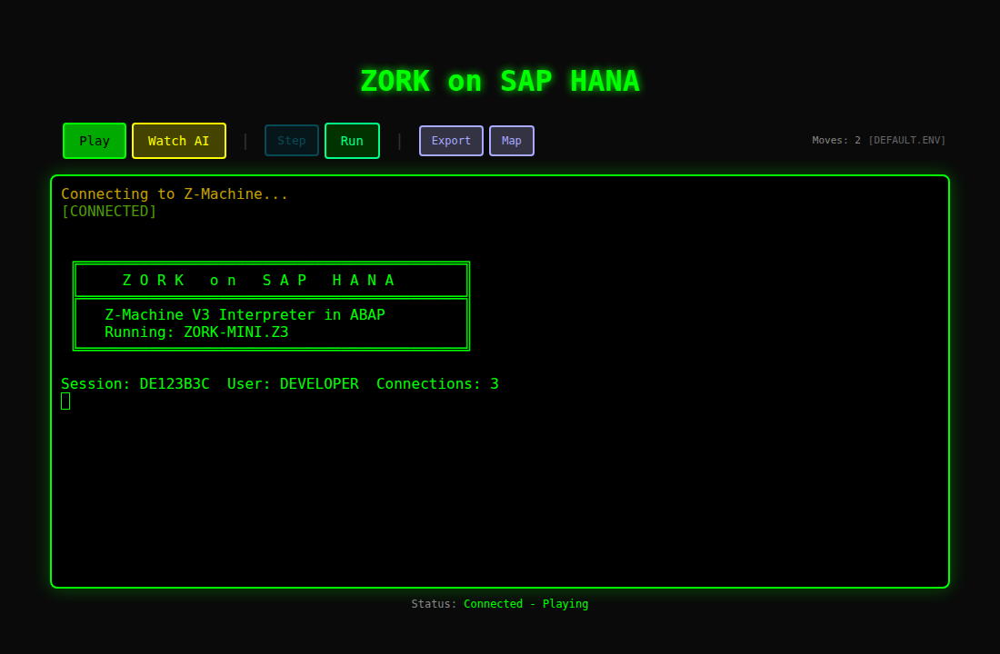
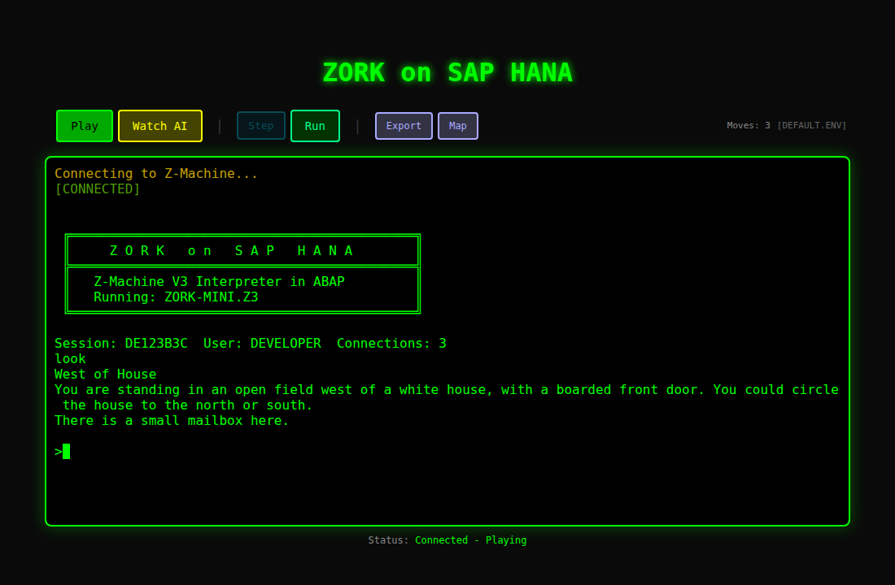
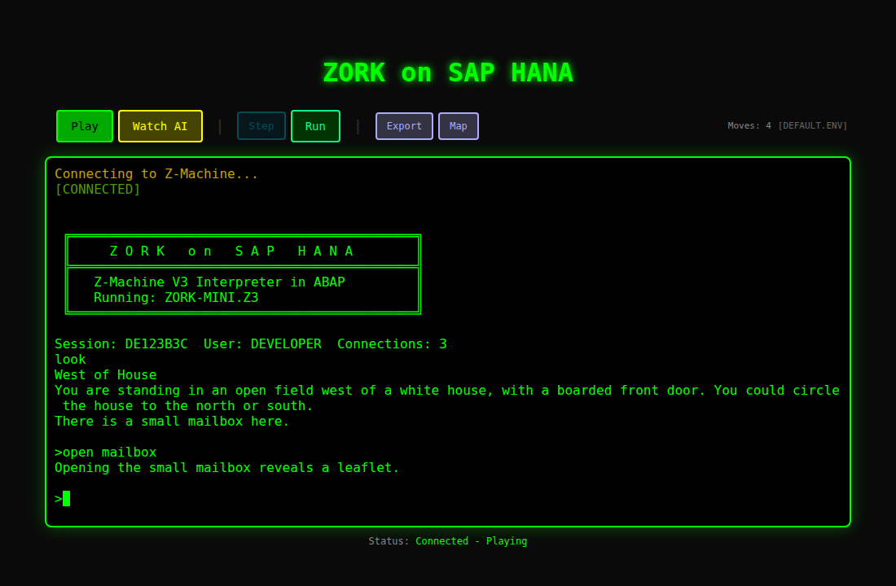
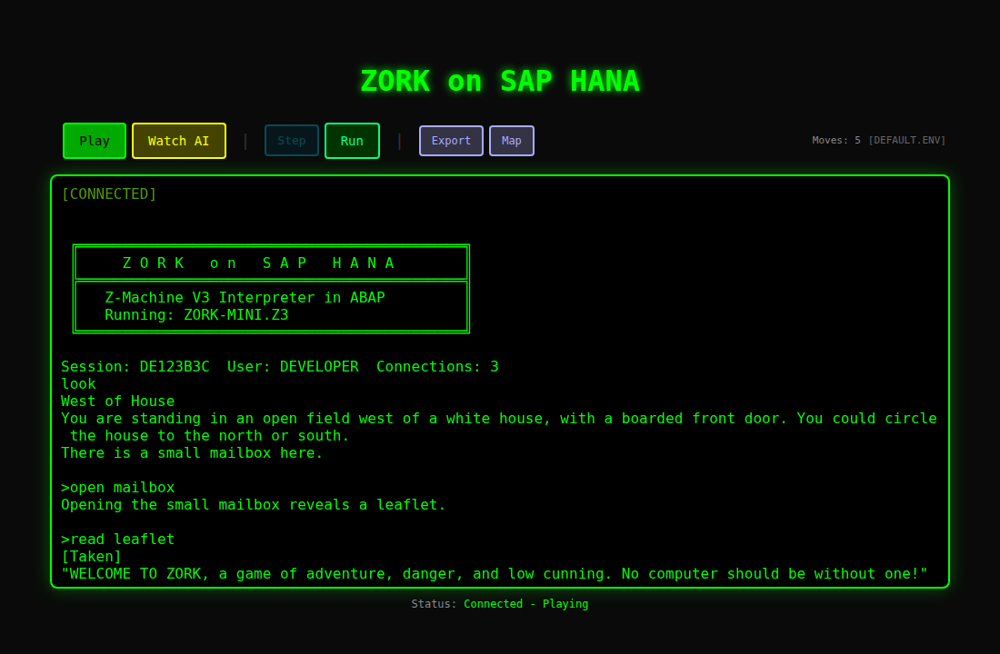
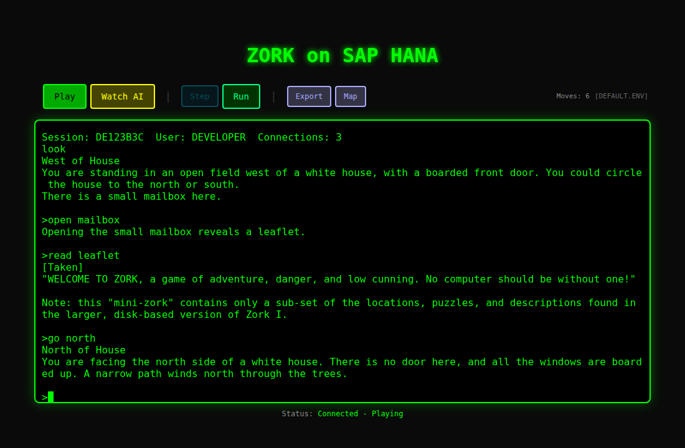

# Serving rescued HTTP code over its own HANA database

> **Do not run your SAP application this way in production.** This is a
> check of rescued code on your own bed: does the code you extracted
> (docs/hana-rescue.md) still answer its HTTP routes when it reads the very
> database it came out of? The host binds to loopback, answers GET and HEAD
> only, and the database session is read-only. Nothing here replaces an
> application server.

`tools/hana-serve.mjs` is the read-only host over a HANA schema an SAP
system already holds (docs/db-backends.md, "Existing schema, read-only").
It served OData. Asked to, it now also serves the tenant's own ICF nodes
(`--icf`), and it reads SMW0 MIME objects out of the tenant's `WWWDATA`
when the ABAP asks for one (`--w3mi`; `--w3mi-check` implies it). Without
the flags a boot reads neither, exactly as an OData-only boot did before.
Zork (the [zork-abap](https://github.com/oisee/zork-abap) interpreter,
rescued from a tenant) is the worked example; nothing in the code knows it.

## What it does

**ICF routes from the tenant's rows** (`tools/hana-serve-icf.mjs`). The
tenant's `ICFSERVICE` has no URL column and no `ICFACTIVE`; the tree's own
table has both, which is why the ordinary routing
(`tools/osd-icf-routing.mjs`) cannot read a tenant. A node's path is built
by walking its `ICFPARGUID` chain up to the virtual host (`DEFAULT_HOST`):
one segment per node, the external name (`ICFALTNME`) where it has one,
else `ICF_NAME`, lower case. The virtual host is not a segment, and a node
whose chain does not reach it is not served.

- **Activation is read from `ICFSERVLOC`** (`ICFACTIVE = 'X'`; measured on
  the bed: 327 of 3444 rows active, the rescued node's among them). A node
  is served only when it and every node above it, up to the virtual host,
  have an active row; a node without a row is not active. `ICFSERVLOC` is
  read schema-qualified on the tenant (`HANA_SCHEMA`; the table is
  client-independent, so this reads what a synonym would) so that no shadow
  object is made for it. When it cannot be read, activation is unknown,
  every node present with a handler counts as active, and the host warns.
- A node is mounted only when its `ICFHANDLER` chain is **one** ABAP class
  (`ICFTYP` A) **that the generation holds**. A system runs a chain of
  several handlers in `ICFORDER` until one of them answers; this host does
  not, so such a node (13 on the bed) is counted and not mounted. A
  system's tree names hundreds of handlers; the island holds the few the
  rescued code brings, and the startup line counts both. Two nodes whose
  paths differ only by case keep the first, and the line says so.
- Each request runs like an OData one: one dialog step, one stub-trace
  record, the tamper gate, and the refusals before a line of ABAP runs --
  any method but GET and HEAD (405), a method-override header (405), another
  `sap-client` than `OSD_CLIENT` (400). `/sap/opu/odata` and `/app` are not
  taken by a tenant node.

**W3MI from WWWDATA.** open-abap-core's `WWWDATA_IMPORT` answers an object
it knows (`abap.W3MI`) through the host hook `abap.W3MI_LOADER` when there
is one. At boot the host registers every `RELID = 'MI'` object of the
tenant's `WWWPARAMS` (one read) and installs a loader that, when asked,
reads the object's `WWWDATA` rows, joins the fragments by `SRTF2` (each cut
to its `CLUSTR`), decodes the data cluster (`tools/protocols/sap-cluster.mjs`,
the flat shapes of vsp's `cluster decode`, over the SAP-LZH decoder in
`tools/protocols/sap-compress.mjs`) and cuts the `MIME` table's 255-byte
lines to `WWWPARAMS` `filesize`. An object the generation brought itself is
still read from the disk, unless the tenant holds the same name.

`--w3mi-check <OBJID>` (repeatable) reads one object through the function
module itself at boot and prints its size and SHA-256 and whether the ABAP
got the same bytes.

## The serve scope: only what the route needs

A package that holds an HTTP handler can also hold GUI reports and a push
channel that pulls a whole library in, and the closure walk
(`tools/hana-closure.mjs`) closes all of it. The part the route never runs
is where the build breaks. `tools/hana-serve-scope.mjs` cuts the island to
what named roots reach:

```sh
node tools/hana-serve-scope.mjs --root <HANDLER_CLASS> [--root <CLASS>]...
node tools/hana-serve-scope.mjs --show
node tools/hana-serve-scope.mjs --clear      # before the closure walks again
```

- The roots are named, never guessed: the handler class, and any class a
  check calls. The registrations the island carries as files are roots by
  themselves (the handler of each `*.sicf.xml`, the classes of each
  `*.iwsv.xml` and `*.iwmo.xml` under `gen/hana-src` and `gen/hana-segw`).
  A tenant's ICF rows are not files: a handler served from them is named
  with `--root`. A push channel's class (`*.sapc.xml`) is not a root, and
  the tool says when it is cut.
- An island object is kept when a kept object names it: every identifier of
  its `.abap` files (comment lines left out), function modules by the names
  their group's XML lists, dictionary objects through their XML (a table
  names its data elements, a data element its domain, a domain its
  conversion exit's two function modules).
- **Literal names only.** A name written out anywhere keeps its object, so
  for those the cut keeps too much rather than too little. A name computed
  at run time (`CALL METHOD (name)`, `CREATE OBJECT ... TYPE (name)`,
  `CALL FUNCTION lv_name`) is not followed: its target needs its own
  `--root`. The tool lists every kept object that makes such a call.
- Code no root reaches is kept from the build through the closure's own
  exclusion seam (`tools/hana-closure-exclusions.mjs`); the transpiler and
  the report converter skip it and `node tools/osd-inputs.mjs` lists each
  file ("left out"). The files stay in their layers.
- A table of the island no root reaches stays in the build but leaves the
  shadow schema's **eager set**: an existing-schema connect makes no view or
  synonym for it. Without this, the first connect of a cut island would have
  made shadow objects for tables only the left-out code reads. A statement
  that does touch one still meets the 259 fallback.

The record is `gen/hana-closure/serve-scope.json`. It names a real tenant's
objects, so it stays under `gen/` and is never tracked. A record without its
list of left-out objects is refused rather than read as "nothing left out",
and the closure walk refuses to run while a record is there (it would cut
the walk's own build): `--clear`, walk, then write the scope again.

**Packs.** Packs are layered after the island, so a pack object with an
island object's name wins it: the build would run our copy of the code, not
the tenant's. Both the scope CLI (before it writes anything) and `hana-serve`
refuse that build and name the objects. Select the packs a HANA build takes with `OSD_WEB_PACKS`
(`OSD_WEB_PACKS=none` takes none). `packs/zork` is the case in point: it
carries the same `zcl_ork_00_*` classes.

## Run it

The island is in `gen/hana-src` (the closure walk, `docs/hana-rescue.md`).
Credentials come from an env file read in a subshell, never from argv.

```sh
node tools/hana-serve-scope.mjs --root <HTTP_HANDLER> [--root ...]
( set -a; . <env file>; set +a
  STG_DB=hana HANA_EXISTING_SCHEMA=1 OSD_CLIENT=<client> OSD_WEB_PACKS=none \
  OSD_SQL_TRACE=1 node tools/hana-serve.mjs --port <port> \
    --icf --w3mi --w3mi-check <OBJID> [--apc] --stub-trace <file> )
curl -s http://127.0.0.1:<port>/<the node's path>/
node tools/hana-serve.mjs --check-trace <trace>   # nothing but reads was sent
```

The env file carries `HANA_HOST`, `HANA_PORT`, `HANA_USER`, `HANA_PASSWORD`,
`HANA_SCHEMA` (the tenant) and `HANA_OWN_SCHEMA` (a schema of your own,
where the shadow objects live). The DDL the host may send is the shadow
schema's, in your own schema only. `ICFSERVICE` and `ICFHANDLER` are tables
of this tree too (`src/osd/ddic`), so the connect makes a synonym for each
the first time, like any table of the build (on the bed both were already
there). `ICFSERVLOC` gets none (it is read schema-qualified). With `--w3mi`,
a synonym each for `WWWPARAMS` and `WWWDATA`, made by the 259 fallback the
first time they are read:

```sql
CREATE SYNONYM "<OWN_SCHEMA>"."WWWPARAMS" FOR "<TENANT_SCHEMA>"."WWWPARAMS"
CREATE SYNONYM "<OWN_SCHEMA>"."WWWDATA" FOR "<TENANT_SCHEMA>"."WWWDATA"
```

With `--apc`, one more, the same way (`APC_APPL` is client-independent):

```sql
CREATE SYNONYM "<OWN_SCHEMA>"."APC_APPL" FOR "<TENANT_SCHEMA>"."APC_APPL"
```

## Measured on the bed (2026-11-18)

Zork's island, roots the HTTP handler, the Z-machine and the SMW0 game
loader: 9 code objects kept, 104 left out (the push channel, the GUI reports,
the LLM library the push channel pulls in, and its closure), 18 tables out
of the eager set. Then:

- `GET /sap/bc/zork/` 200, `text/html`, 12930 bytes, the tenant's handler
  class over its own node; HEAD 200; POST 405; another client 400.
- `--w3mi-check` of the story file: 52216 bytes out of `WWWDATA`, SHA-256
  `c74f01a2...ea4a6`, equal to `src/zork_02/zork-mini-z3.w3mi.data.z3` of
  zork-abap at `0c8d96b9`.
- The tenant's Z-machine over that story, loaded by the tenant's own SMW0
  loader in the same process: "open mailbox" answers "Opening the small
  mailbox reveals a leaflet."
- `--check-trace`: the positive control on both channels, no write; the
  only DDL the two synonyms above.

The page then opens a websocket to the push channel; that is the next part.

## APC: the push channel

`--apc` serves the tenant's push channels. They are rows of `APC_APPL` --
one per application: its `PATH` (the URL a page opens the websocket on),
its `CLASS_NAME`, `STATEFUL` -- the fields a `*.sapc.xml` carries, so a row
becomes the channel `tools/osd-apc.mjs` `mountChannels` takes
(`tenantChannels` in `tools/hana-serve-icf.mjs`). Only the active version
and only websocket applications (`CONNECTION_TYPE` blank; `T` is plain TCP)
are channels, and only when the class is in the generation, like a node's
handler. A path is matched without regard to case, as the ICF matches it.

- The channel is mounted on the same loopback listener. Every event
  (`on_start`, each message, `on_close`) is a dialog step of its own
  (`tools/osd-dialog-step.mjs`): it takes the one work process, commits or
  rolls back at its end, and runs on the same read-only connection, so a
  write is refused there and shows in the trace like an HTTP request's.
- Every event first checks the host's guard (`integrity()`, as each HTTP
  request does): a guard that is no longer the one installed runs no ABAP
  and closes the socket 1011 ("host guard not intact"). Each event gets its
  own line in the stub trace (`{channel, event, outcome, stubs, ...}`), and
  an event that asked for a write is said the way an HTTP request's is
  (`hana-serve: APC <path> on_message asked for 1 write(s): ...`); the
  database refuses it, the event dumps, the socket closes 1011
  (`test/hana-serve.mjs`, over the fake client).
- An upgrade from another `sap-client`, or to a host whose guard is no
  longer intact, is refused before any ABAP runs (`admit` in
  `mountChannels`). The channels are mounted before the listener opens.

Two transpiler gaps stood between Zork's channel class and a socket; both
are fixed upstream since 2.14.38 (abaplint/transpiler#2134 and #2135, in the
pin `local/osd-build-4m`):
`EXPORT`/`IMPORT ... SHARED MEMORY` / `SHARED BUFFER`, which the class uses
to count its connections (ANORMALIES
`ANOMALY-2026-11-18-export-import-shared-memory`, test
`test/unit/zcl_osd_shared_memory_test`), and `TYPE decfloat16`, in its
session expiry check (`ANOMALY-2026-11-18-decfloat16-type-todo`).

### Members typed by a library the route does not run

The same class also drives an AI player: attributes typed by an LLM
library, methods that call into it. Kept as a root, it keeps the whole
library and its closure, and that is where the build breaks.
`--cut-members-typed-by <PACKAGE>` (repeatable) on the scope stops the walk
at that package (`tools/hana-serve-cut.mjs`):

- a name a kept object outside the package gives to an object inside it is
  not followed; the object stays only when something else keeps it (a root,
  or a kept object of that package);
- in the kept class, an attribute `TYPE REF TO <left-out object>` becomes
  `TYPE REF TO object` (CLEAR, IS BOUND and IS INITIAL still mean what they
  meant), and a method whose body names a left-out object, or calls through
  such an attribute, gets the closure's stub body: `RAISE EXCEPTION TYPE
  zcx_osd_not_activated` with the missing names. Loud: the raise names what
  is missing and the host's stub trace records it;
- anything else in a definition that names a left-out object (a parameter,
  a type, `INHERITING FROM`) is refused by name;
- the rewritten classes go into one more island folder,
  `gen/hana-src/999-serve-scope`, which sorts after every closure layer and
  so wins the name (`node tools/osd-inputs.mjs` lists the override); the
  closure's layers stay as the walk wrote them, and `--clear` removes the
  overlay with the record. The overlay is cut in a folder beside the island
  and renamed into place only when every class is done, so a refused cut
  leaves the overlay it found. The build reads it only beside its record:
  an overlay with no record, or with other files than the record's
  `memberCuts` list, is refused where the build reads the scope
  (`tools/hana-closure-exclusions.mjs`). The record may live elsewhere
  (`OSD_HANA_CLOSURE_OUT`); the overlay is always in the island of the root
  the scope cut, since that is where the build takes its layers from.

```sh
node tools/hana-serve-scope.mjs --root <HTTP_HANDLER> --root <APC_CLASS> \
  [--root <A_CLASS_OF_THE_LIBRARY_THE_ROUTE_DOES_RUN>] \
  --cut-members-typed-by <PACKAGE> [--cut-members-typed-by <PACKAGE>]
```

The identifier walk is coarse on purpose and keeps an object a string
literal or a trailing comment names. When that object's package is not one
the route runs, naming the package is how it goes.

### Measured on the bed (2026-11-18)

Roots: the HTTP handler, the Z-machine, the SMW0 loader, the channel class
and the game tracker the channel keeps in play (the one class of the LLM
library that play mode calls; it keeps four more of its package); the LLM package and the package of an error
class the channel names only in a literal cut: 28 objects kept, 96 left
out; in the channel class 4 attributes retyped and 4 methods stubbed (the
AI framework, its steps and turns, and the save of an AI session).

- Boot with `--icf --w3mi --apc`: 64 rows in `APC_APPL`, 59 active
  websocket ones, 1 with its class in the generation, mounted at its path.
- Headless Chromium on `http://127.0.0.1:<port>/sap/bc/zork/`: the page's
  websocket connects, the banner and the session line arrive (the
  connection count read back out of `SHARED MEMORY`), and the game plays:
  `look`, `open mailbox` ("Opening the small mailbox reveals a leaflet."),
  `read leaflet`, `go north`.
- `--check-trace`: the positive control on both channels, 0 writes; the
  only DDL of the stage the `APC_APPL` synonym above, on the first boot.
- Known: closing the page runs `on_close`, which saves the AI session
  first -- a stubbed method -- so it raises (logged, and in the stub trace)
  before it unregisters the connection, and the count in the banner keeps
  connections that are gone until the class's own expiry drops them.






