# Rescue $ZORK: a worked example

This page walks through one real rescue, start to finish. The general guide
is [`hana-rescue.md`](hana-rescue.md); read it for the flags, the report
states and the known limits. This page does not repeat them.

**The case.** [zork-abap](https://github.com/oisee/zork-abap), a Z-machine
interpreter written in ABAP, was installed on a sandbox system in four local
packages: `$ZORK` and its children `$ZORK_00`, `$ZORK_01`, `$ZORK_02`. The
application server of that system is gone. The HANA tenant behind it is
still running. The job is to get the code back as an abapGit repository.

Measured on 2026-11-18 with release
[`vscode-stable-v0.7.3131`](https://github.com/oisee/open-steamgate/releases/tag/vscode-stable-v0.7.3131)
(the `osd-linux-x64` binary and `open-steamgate-linux-x64-0.7.3131.vsix`,
both checked against their `.sha256` files) and the pinned sidecar
`osd-hana-dump` v2.62.1. Host, port, tenant, user, schema and author names in
the examples and screenshots are placeholders.

The run found three defects in 0.7.3131. They are fixed in
[#983](https://github.com/oisee/open-steamgate/pull/983), which will be in
the **next release** (it has no version number yet). This page shows both:
what works with 0.7.3131, and the shorter route once the fix is released. The
VS Code screenshots were taken with the fix applied.

## Which route

| situation | route |
|---|---|
| the ABAP server still runs | export from the server: abapGit, or `vsp export` (below) |
| the server is gone, the database is not | `osd hana extract` on the command line |
| the same, from VS Code | "OSD: Extract my code from HANA" with **Only package…**, from the next release on ([section 3](#3-vs-code)) |

A live server knows things the database does not show: screens, GUI
statuses, transactions, MIME objects. If the server can still be started,
export from it first.

## 1. While the server is alive: `vsp export` (not run for this guide)

[vsp](https://github.com/oisee/vibing-steampunk) exports packages as an
abapGit ZIP through its `ZADT_VSP` WebSocket service on the ABAP server
(see "Export & Import" in its
[`docs/cli-guide.md`](https://github.com/oisee/vibing-steampunk/blob/main/docs/cli-guide.md)):

```sh
vsp export '$ZORK' -o zork.zip --subpackages
```

It needs a running ABAP server with `ZADT_VSP` installed. The server in this
example was no longer reachable, so this route was **not run** here. abapGit
itself (online or offline repository) is the other server-side route.

## 2. The server is gone: the command line

Get `osd` and the sidecar as described in
[Getting the tool](hana-rescue.md#getting-the-tool), then point `osd` at the
sidecar:

```sh
export OSD_HANA_DUMP=~/bin/osd-hana-dump-linux-amd64
```

The password is never a flag. Without `--password-stdin` or
`OSD_HANA_PASSWORD`, `osd` asks for it on the terminal.

### Is the code still there?

```sh
osd hana doctor --host hana.example --port 30015 --database TENANT --user RESCUER
```

```text
Verdict for the ABAP rescue:
  Reachable: yes -- logged on as RESCUER to hana.example, a tenant database.
  ABAP schema <SCHEMA>: found, release 758/0000000002, clients 000, 001, repository: 3018348 source rows (REPOSRC), 1339131 repository objects (TADIR).
  ABAP server still attached: unknown (informational -- this login may not see the sessions).
  This login is another kind of login (not the schema owner, not an administrator) and can only read.
  TLS: off -- the connection is NOT encrypted.
  Ready to extract: yes -- the next step is `osd hana extract`.
```

Exit code 0. The login is a plain read-only user, which is all the rescue
needs.

### Look at the plan first

```sh
osd hana extract --host hana.example --port 30015 --database TENANT --user RESCUER \
  --package '$ZORK%' --out ~/rescue/zork --dry-run
```

With 0.7.3131, add `--no-local` (see below).

```text
plan: 29 objects in scope (system holds 29: 29 customer, 0 sap)
  per type:
    CLAS         14      0.1 MB
    INTF          2      0.0 MB
    PROG          3      0.0 MB
    SAPC          1      0.0 MB  (unsupported -- will be listed, not written)
    SICF          2      0.0 MB  (unsupported -- will be listed, not written)
    SUSH          1      0.0 MB  (unsupported -- will be listed, not written)
    TRAN          2      0.0 MB  (unsupported -- will be listed, not written)
    W3MI          4      0.0 MB  (unsupported -- will be listed, not written)
  per package:
    $ZORK                                 4      0.0 MB
    $ZORK_00                             14      0.1 MB
    $ZORK_01                              5      0.0 MB
    $ZORK_02                              6      0.0 MB
  per author (local objects):
    ZORK_DEV                             29      0.2 MB
```

`'$ZORK%'` takes the package and its three children. Listing the four
packages with four `--package` flags gives the same 29 objects.

With 0.7.3131, two things about the selection behave differently. Both are
fixed in the next release:

- **`--package` alone does not narrow.** Local packages are in scope by
  default, and in 0.7.3131 a `--package` without `--no-local` was added to
  that default instead of narrowing it: the plan held every local object of
  the system, 22 828 of them. With `--no-local` next to it, the selection is
  exactly the packages named, `$` packages included. From the next release
  on, `--package` narrows on its own.
- **The wildcard is `%`.** In 0.7.3131 `'$ZORK*'` matched nothing. From the
  next release on, `*` works too and is sent as `%`.

### Extract

The same command without `--dry-run`. On a terminal it prints the plan and
asks `extract 29 objects (0.2 MB) into ~/rescue/zork?`; `--yes` answers for a
script. The end of the console output:

```text
sources: 255 programs in 1 statements
sources: 255 written, 0 failed to decode
table TADIR: 19 rows
table TRDIR: 255 rows
...
extract-report: ~/rescue/zork/extract-report.md
10 objects of 29 could not be fully extracted (SAPC 1, SICF 2, SUSH 1, TRAN 2, W3MI 4). 19 objects written. For 19 of them this tool could not check: component texts (SEOCOMPOTX) 16, dynpros 3, GUI status 3, variants 3.
```

Exit code 3 ("partial"), after 2.8 s. What that means, object by object:

| type | in scope | written | unsupported |
|---|---|---|---|
| CLAS | 14 | 14 | |
| INTF | 2 | 2 | |
| PROG | 3 | 3 | |
| SAPC, SICF, SUSH, TRAN, W3MI | 10 | | 10 |
| **total** | **29** | **19** | **10** |

No object is `written-partial` or `skipped`. The 10 unsupported objects are
the APC application, two ICF nodes, an authorization default, two
transactions and the four MIME objects (the story files); they are listed in
the report and not written. The "could not check" parts are the kinds the
dump does not carry (component texts, screens, GUI statuses, variants).

The result is 41 files under `src/` (22 `.abap`, 19 `.xml`, 176 161 bytes)
plus `.abapgit.xml`, folder logic FULL, master language E:

```text
src/zork_00/   12 classes and 2 interfaces (31 files)
src/zork_01/    3 programs (6 files)
src/zork_02/    2 classes (4 files)
```

`$ZORK` itself holds only the four MIME objects, so it gets no folder.
Before you publish the folder, delete `extract-report.md`,
`extract-report.json` and `.osd-hana/` (see
[What lands in the output folder](hana-rescue.md#what-lands-in-the-output-folder)).

## 3. VS Code

Install `open-steamgate-<platform>-<version>.vsix` from the release (the
platform package carries the sidecar). The command needs the osd-hana tools:
an open-steamgate checkout (setting `osd.home`, or the open workspace
folder), or the bundled system after its first Start.

The **Only package…** step below is new in the next release
([#983](https://github.com/oisee/open-steamgate/pull/983)). The screenshots
were taken with the 0.7.3131 extension, its command file replaced by the one
from #983 and `osd.home` pointing at a checkout of #983. With 0.7.3131 itself
the plan offers only one author or "leave local packages out", and the
narrowest scope that holds `$ZORK` on this database (its author's 1 513
objects) stopped with exit code 6. Use the command line with `--no-local`
(section 2) until the next release.

The screenshots are from VS Code 1.147 on Linux. Every host, port, tenant,
user, schema, author and home path in them was replaced before the picture
was taken.

**Command palette:** "OSD: Extract my code from HANA".

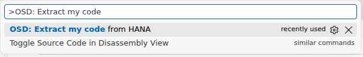

**Connection:** host, port, tenant and user, one box each, then the password
in a password box. It is used for this run only.

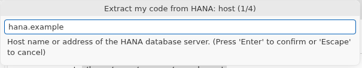

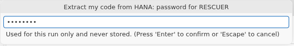

**Doctor:** the check runs in a cancellable notification. The command offers
to remember the connection; the password is never stored.

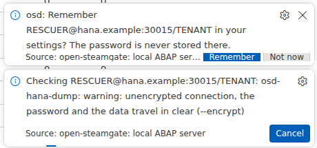

The verdict is the same text as `osd hana doctor`:

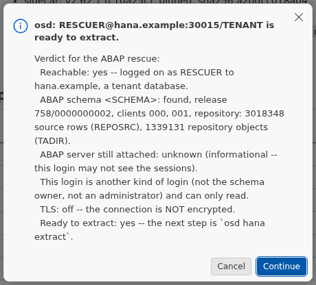

**Plan:** everything the login can see that counts as yours. On this sandbox
that is 22 828 local objects of nine authors (all of them masked here, the
author of `$ZORK` as ZORK_DEV).

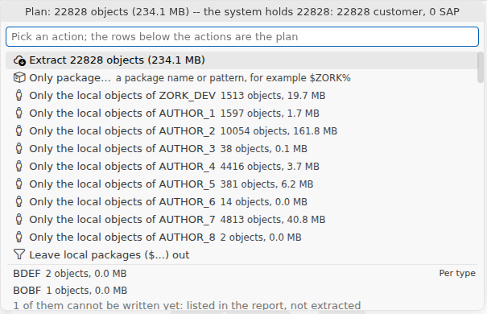

**Only package…** narrows to a package name or pattern:

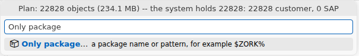

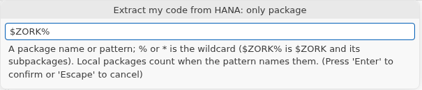

The plan is listed again, now for the 29 objects of `$ZORK` and its
subpackages, the same numbers as on the command line:

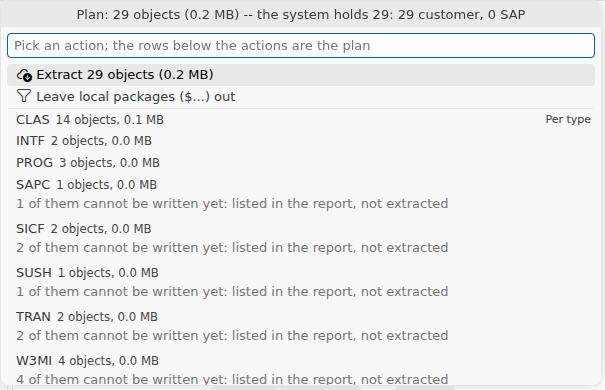

**Folder and consent:** an empty folder, then the question with the numbers
of the plan. Nothing is dumped before **Extract**.

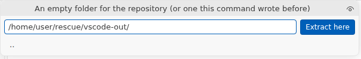

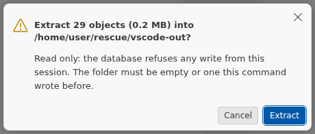

**Progress:** cancellable; the line shows what the sidecar is doing.

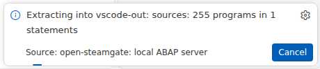

**Done:** the report opens, and the notification carries its first
sentence. It is a warning here because 10 objects are unsupported (exit 3).

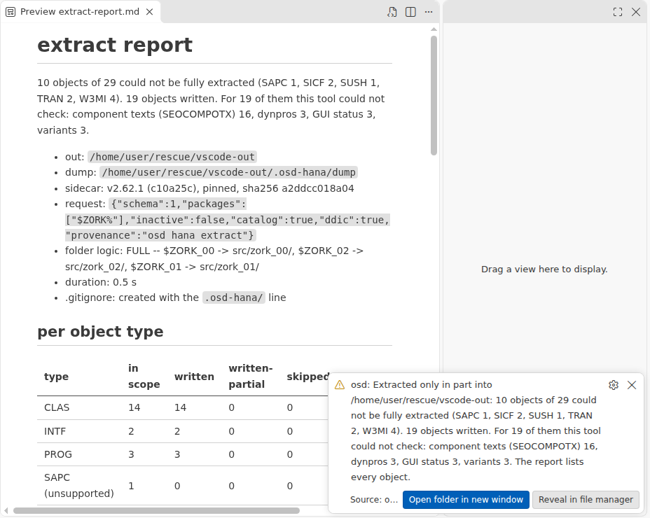

The folder is the same repository the command line wrote:

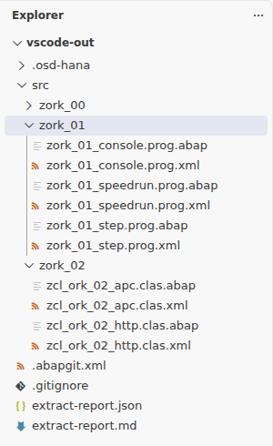

## 4. The proof

**Same input, same bytes.** Four runs into four empty folders wrote the
same 43 files (41 under `src/`, `.abapgit.xml`, `.gitignore`), each with the
same SHA-256:

| run | command |
|---|---|
| command line, 0.7.3131 (twice) | `--no-local --package '$ZORK%'` |
| command line, #983 | `--package '$ZORK%'` |
| VS Code, #983 | **Only package…** `$ZORK%` |

**Against the public source.** The 41 rescued files were compared byte for
byte with [zork-abap](https://github.com/oisee/zork-abap):

| compared with | identical | different | only rescued | only upstream |
|---|---|---|---|---|
| commit `0c8d96b`, the one `packs/zork` pins | 18 | 19 | 4 | 19 |
| commit `dfaef62` (2025-12-10), the best match on `main` | 35 | 2 | 4 | 14 |

The system held an older version than the commit the pack pins: 39 of the 41
files are byte-identical to a file somewhere in the repository's history.
Against `dfaef62`:

- the 4 files only in the rescue are the two classes of `$ZORK_02`; each is
  byte-identical to the file at the same path on the repository's
  `apc-console` branch, which was never merged into `main`;
- `zork_01_console.prog.xml` is identical to upstream once upstream's screen
  and GUI-status blocks are taken out: the dump carries neither (the report
  says "not checked" for both);
- `zcl_ork_00_speedrun.clas.abap` differs from every commit by one comment
  line. That edit was made on the system and never pushed, and the rescue is
  the only copy of it.

The 14 files only upstream are three `package.devc.xml` files (the extract
writes none), the screen include, the two transactions and the four MIME
objects with their data files (not written, see above). Against `0c8d96b`
the extra upstream files also include four unit-test includes added after
the system's version.

## 5. Running what you rescued

Not shown. The rescued folder holds the interpreter but not the story file
(MIME objects are not extracted), so it does not start on its own. The
`packs/zork` pack in this repository runs the same interpreter with a story
file it carries itself (`packs/zork/src`).

## Known limits seen in this example

All of [Known limits](hana-rescue.md#known-limits) apply. These came up here:

- MIME objects, transactions, ICF nodes, APC applications and authorization
  defaults are `unsupported`: listed, not written.
- No `package.devc.xml` is written.
- Screens and GUI statuses are not in the dump.

Fixed in the next release ([#983](https://github.com/oisee/open-steamgate/pull/983)),
present in 0.7.3131:

- `--package` narrows only together with `--no-local`, and `*` is not a
  wildcard.
- The VS Code command has no package filter.
- A dump chunk that holds only MIME objects stops the conversion with exit
  code 6; and in a dump of more than 500 objects the converter looked for
  every source in the wrong folder (found while fixing the exit 6).
